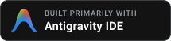
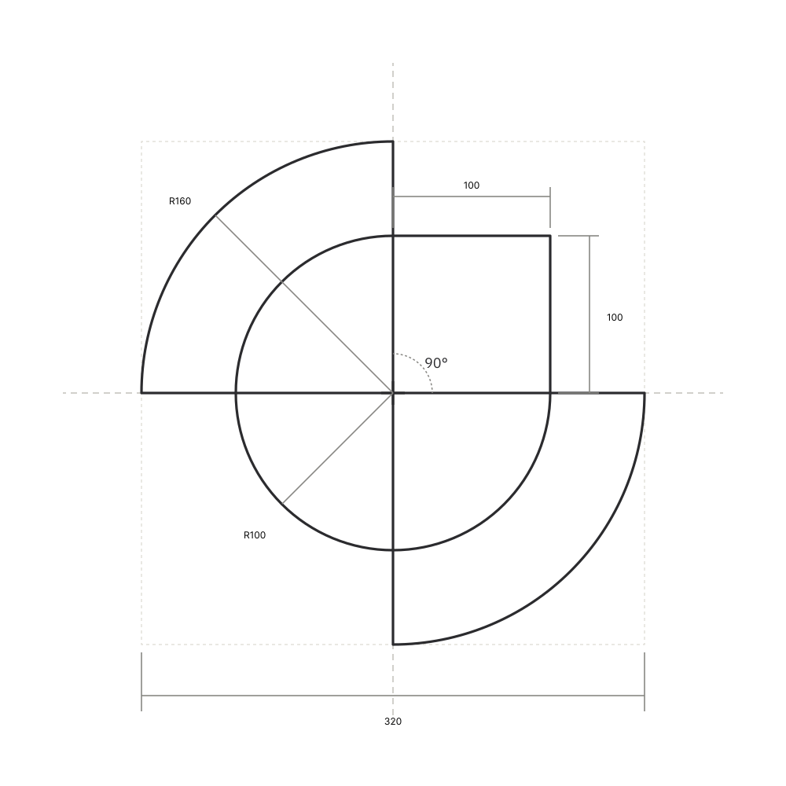

# Knoblab

> Personal development namespace and experimental laboratory for web engineering.

[](https://github.com/knoblab)
[](https://www.npmjs.com/package/wodn.js)

```bash
$ npx wodn.js
```

[](https://antigravity.google)
<br>
[](https://knoblab.github.io/knoblab)

---

## Projects

[](https://github.com/knoblab/KNDS)
[](https://github.com/knoblab/freeview-sni)
[](https://www.npmjs.com/package/wodn.js)

## Contact
- Terminal: `npx wodn.js`
- GitHub: [@knoblab](https://github.com/knoblab)
- Mail: contact@knoblab.xyz

---

